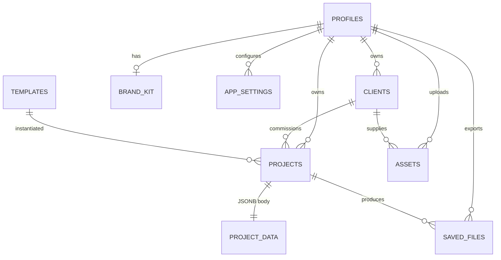

# Aura Studio — Personalized Database Design & Documentation

**Version:** 0.1 (Draft)
**Date:** 2026-11-04
**Status:** Documentation phase — schema implementation to follow
**Owner:** Aura Studio / Creative Studio project

---

## 1. Purpose & Goals

Aura Studio today runs entirely in the browser: members, brand kits, designs,
custom templates, and the media library live in `localStorage` / IndexedDB.
This document specifies the **online personalized database** that replaces and
extends that storage — an enterprise-grade, SQL-first backend (Oracle-class
reliability at commodity cost) with a per-user, personalized experience
(V-style: every member sees *their own* studio, clients, and assets).

### Goals

1. **Single source of truth** — replace scattered localStorage keys
   (`aura.members`, `aura.m.<user>.*`, `aura.project.*`, `aura.brand`,
   `aura.customTemplates`, `aura.aiCloud`) with normalized SQL tables.
2. **Personalization by default** — Row-Level Security (RLS) so every member
   only ever sees their own data, enforced *in the database*, not the app.
3. **Client data support** — members can attach designs, assets, and saved
   files to client records.
4. **Media at scale** — images and videos move from IndexedDB to object
   storage, with metadata in SQL.
5. **Flexible schema** — JSONB for user-defined design data and custom
   fields, relational tables for core entities.

### Non-goals (for v1)

- Multi-tenant organizations / teams (schema reserves the hooks, single-owner
  model first).
- Realtime collaborative editing (designs remain single-editor).

---

## 2. Architecture

```
┌─────────────────────────────┐
│   Aura Studio (web client)  │   index.html · app.js · admin.html
│   React-ready, today vanilla│
└──────────────┬──────────────┘
               │ HTTPS (REST / GraphQL / SQL-over-HTTP)
┌──────────────▼──────────────┐
│      Supabase platform      │
│  ┌────────────────────────┐ │
│  │ PostgreSQL 15+         │ │  ← all relational data (Oracle-class core)
│  │ + Row-Level Security   │ │
│  └────────────────────────┘ │
│  ┌────────────────────────┐ │
│  │ Storage (S3-compatible)│ │  ← images, videos, saved files
│  └────────────────────────┘ │
│  ┌────────────────────────┐ │
│  │ Auth (JWT)             │ │  ← members; identity feeds RLS
│  └────────────────────────┘ │
└─────────────────────────────┘
```

**Why PostgreSQL instead of Oracle:** identical relational guarantees (ACID,
constraints, triggers, views, RLS) with zero licensing cost and first-class
JSONB — which we need for user-defined design data. Hosted Postgres
(Supabase) includes auth, storage, APIs, backups, and point-in-time recovery.

### Stack decision record

| Layer | Choice | Rationale |
|---|---|---|
| Database | PostgreSQL (Supabase hosted) | RLS, JSONB, GIN indexes, free tier to start |
| Auth | Supabase Auth | Email+password now; OAuth later; integrates with RLS via JWT |
| Files | Supabase Storage buckets | Per-user path policies; CDN; signed URLs |
| API | Auto-generated REST (PostgREST) | No backend server needed for v1 |
| Client | Existing `app.js` extended with a data-access adapter | Incremental migration from localStorage |

---

## 3. Data Model

### 3.1 Entity-Relationship Overview



### 3.2 Table Definitions

All tables use `uuid` primary keys, `created_at timestamptz default now()`,
and `updated_at timestamptz` maintained by trigger.

#### `profiles` — members
Extends the auth user. Mirrors today's `aura.members` store.

| Column | Type | Notes |
|---|---|---|
| `id` | uuid PK | = `auth.users.id` |
| `username` | text unique not null | display/handle (currently the localStorage key) |
| `display_name` | text | |
| `avatar_path` | text | storage path, nullable |
| `role` | text default `'member'` | `member` \| `admin` (Admin Agent uses `admin`) |
| `plan` | text default `'free'` | future upgrade hook |
| `storage_used_bytes` | bigint default 0 | maintained by trigger on assets |

#### `clients` — client data
| Column | Type | Notes |
|---|---|---|
| `id` | uuid PK | |
| `owner_id` | uuid FK→profiles | RLS anchor |
| `name` | text not null | |
| `contact_email` | text | |
| `contact_phone` | text | |
| `notes` | text | |
| `custom_fields` | jsonb default '{}' | user-defined client attributes |
| `archived` | boolean default false | |

#### `projects` — designs / saved work
One row per saved design (today's `aura.project.*` entries).

| Column | Type | Notes |
|---|---|---|
| `id` | uuid PK | |
| `owner_id` | uuid FK→profiles not null | |
| `client_id` | uuid FK→clients null | optional client association |
| `name` | text not null | |
| `template_id` | uuid FK→templates null | if created from a template |
| `width` | int not null | canvas width |
| `height` | int not null | canvas height |
| `category` | text | social · magazine · books · documents · presentations · logos · posters · videos · collages · print |
| `data` | jsonb not null | full canvas document (pages, elements, styles) |
| `thumbnail_path` | text | storage path to preview image |
| `archived` | boolean default false | |

**Index:** GIN on `data` for JSONB queries; btree on `(owner_id, updated_at)`.

#### `templates`
Both built-in (shipped via `templates.js` / update packages) and
member-created custom templates.

| Column | Type | Notes |
|---|---|---|
| `id` | uuid PK | |
| `owner_id` | uuid FK→profiles null | null = system/global template |
| `name` | text not null | |
| `category` | text not null | |
| `width`, `height` | int not null | |
| `data` | jsonb not null | pages/elements payload (update-package shape) |
| `is_builtin` | boolean default false | |
| `version` | text | for update-package versioning (`aura-update.json`) |

#### `assets` — images & videos (media library)
Metadata only; bytes live in Storage.

| Column | Type | Notes |
|---|---|---|
| `id` | uuid PK | |
| `owner_id` | uuid FK→profiles not null | |
| `client_id` | uuid FK→clients null | client-supplied media |
| `kind` | text not null | `image` \| `video` |
| `filename` | text not null | |
| `storage_path` | text not null | `{owner_id}/{asset_id}/{filename}` |
| `mime_type` | text not null | |
| `size_bytes` | bigint not null | |
| `width`, `height` | int null | images |
| `duration_ms` | int null | videos |
| `insertable` | boolean default false | images true; videos true in Phase II |
| `custom_fields` | jsonb default '{}' | tags, alt text, source |

#### `saved_files` — exports & documents
PNGs, zips, `.odt`, `.json` project files, PDFs.

| Column | Type | Notes |
|---|---|---|
| `id` | uuid PK | |
| `owner_id` | uuid FK→profiles not null | |
| `project_id` | uuid FK→projects null | export origin |
| `client_id` | uuid FK→clients null | delivered-to client |
| `kind` | text not null | `png` \| `zip` \| `odt` \| `json` \| `pdf` \| `svg` \| `other` |
| `label` | text not null | human-readable name |
| `storage_path` | text not null | |
| `mime_type`, `size_bytes` | | |

#### `brand_kits` — one per member
| Column | Type | Notes |
|---|---|---|
| `id` | uuid PK | |
| `owner_id` | uuid FK→profiles unique | today's `aura.brand` |
| `colors` | text[] | palette |
| `font` | text | |
| `logo_path` | text | storage path |

#### `app_settings` — per-member preferences
Key/value with JSONB (replaces `aura.aiCloud` and future toggles).

| Column | Type | Notes |
|---|---|---|
| `id` | uuid PK | |
| `owner_id` | uuid FK→profiles | |
| `key` | text not null | e.g. `aiCloud`, `uiTheme` |
| `value` | jsonb not null | |
| unique | `(owner_id, key)` | |

#### `audit_log` — optional v1.1
`id, actor_id, action, entity_type, entity_id, detail jsonb, created_at`.
Append-only; RLS = actor can read own rows.

### 3.3 Personalization strategy

- **Every user-owned table carries `owner_id`** and an RLS policy:
  `USING (owner_id = auth.uid())` / `WITH CHECK (owner_id = auth.uid())`.
- **`admin` role** bypasses via a `is_admin()` security-definer function.
- **Custom fields** live in JSONB columns (`clients.custom_fields`,
  `assets.custom_fields`) so members can add attributes without migrations —
  the "personalized schema" experience. GIN-indexed for filter/sort speed.

---

## 4. Storage Design (images, videos, saved files)

| Bucket | Access | Contents | Limits |
|---|---|---|---|
| `assets` | owner-only (policy on path prefix `{owner_id}/`) | images, videos | image ≤ 25 MB, video ≤ 500 MB |
| `saved-files` | owner-only | exports (.png/.zip/.odt/.pdf) | ≤ 200 MB |
| `public` | world-read | logos, published thumbnails | ≤ 5 MB |

Path convention: `{bucket}/{owner_id}/{entity_id}/{filename}` — this makes
owner enforcement a simple path-prefix policy and keeps per-user cleanup
trivial.

Thumbnails: generated client-side on export (canvas → blob), stored in
`saved-files` and referenced from `projects.thumbnail_path`.

---

## 5. Security Model

1. **RLS everywhere.** No table is exposed without a policy. Anonymous
   requests see zero rows.
2. **Auth → identity.** Supabase JWT; `auth.uid()` is the RLS anchor.
3. **Storage policies mirror RLS** via path-prefix ownership.
4. **Admin Agent (`admin.html`)** requires `profiles.role = 'admin'`;
   system templates and update packages are writable only by admins.
5. **Uploads validated** client-side and by DB constraints on `kind`/`mime_type`.
6. **Backups:** daily + point-in-time recovery (Supabase managed).

---

## 6. Migration Plan — localStorage → Database

Today's client keys map as follows:

| Current localStorage key | Destination |
|---|---|
| `aura.members` (`{members:{user:{pass,salt}}}`) | `auth.users` + `profiles` (passwords re-hashed by Auth; never migrated in plaintext) |
| `aura.currentMember` | Supabase session (JWT) |
| `aura.m.<user>.project` (autosave) | `projects.data` (autosave project) |
| `aura.project.*` (saved designs) | `projects` rows |
| `aura.brand` | `brand_kits` |
| `aura.customTemplates` | `templates` (owner-set) |
| Media library (IndexedDB blobs) | `assets` rows + Storage uploads |
| `aura.aiCloud` | `app_settings[key='aiCloud']` |

### Migration sequence (phases)

1. **Phase 0 — Adapter.** Introduce `dataLayer` in `app.js`: same read/write
   API, backed by Supabase when online, localStorage when offline. Nothing
   breaks.
2. **Phase 1 — Auth & profiles.** Sign-up/sign-in moves to Supabase Auth;
   `aura.members` becomes read-only legacy.
3. **Phase 2 — Projects & templates.** Sync saved designs and custom
   templates; JSON payloads unchanged (same document shape), so
   `hydrate()` needs no changes.
4. **Phase 3 — Assets.** Media library uploads to Storage; IndexedDB becomes
   an offline cache only.
5. **Phase 4 — Clients & saved files.** New features enabled by the backend.
6. **Phase 5 — Offline deprecation.** Remove localStorage writes; keep an
   export tool for one-time local backup.

**Offline-first note:** the adapter keeps localStorage fallback so the app
still works with no connection (current product promise), syncing when
online. Conflict rule: last-write-wins per project, with local backup copy.

---

## 7. API Access Patterns (examples)

```js
// Sign in
await supabase.auth.signInWithPassword({ email, password });

// List my projects, newest first
const { data } = await supabase
  .from('projects')
  .select('id,name,width,height,category,thumbnail_path,updated_at')
  .order('updated_at', { ascending: false });

// Save design (upsert on client-generated id)
await supabase.from('projects').upsert({ id, name, width, height, data });

// Upload media
await supabase.storage.from('assets')
  .upload(`${user.id}/${crypto.randomUUID()}/hero.png`, file);

// Client's projects
const { data } = await supabase
  .from('projects').select('*').eq('client_id', clientId);
```

No custom server required for v1 — PostgREST serves these directly, with RLS
scoping every response to the caller.

---

## 8. Roadmap

| Phase | Deliverable | Status |
|---|---|---|
| 0 | This documentation | ✅ this doc |
| 0.5 | `dataLayer.js` dual-backend adapter (write-through sync, offline queue, migration tool) | ✅ `dataLayer.js` + `docs/DATALAYER.md` |
| 1 | SQL migration script (schema + RLS + triggers) | next |
| 2 | Cloud-first reads + autosave synced as projects | planned |
| 3 | Auth integration + member migration | planned |
| 4 | Media library → Storage | planned |
| 5 | Clients & saved-files features | planned |
| 6 | Admin Agent against DB (system templates, updates) | planned |

---

## 9. Open Questions

1. Self-host (Supabase OSS on a VPS) vs. managed cloud? *(Recommend managed to start.)*
2. Client data: should clients get portal access (login as client) in v2?
3. Retention policy for deleted assets (soft-delete window)?
4. Quota per member (drives `storage_used_bytes` trigger design)?
